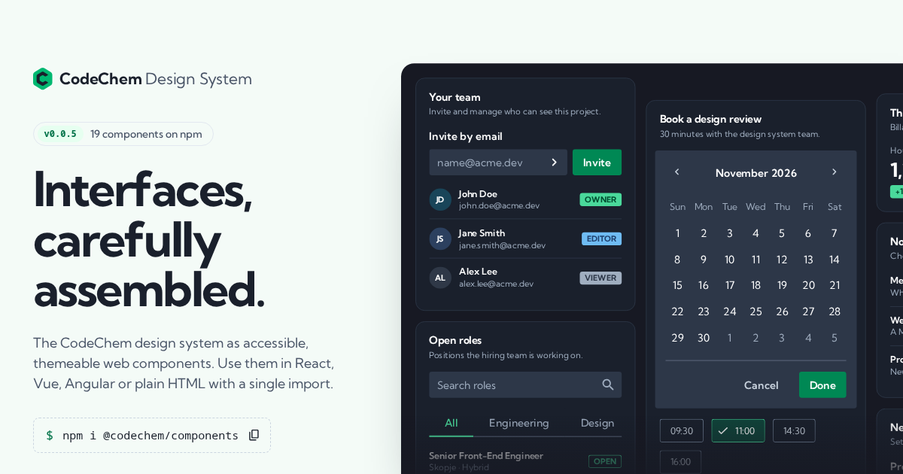

# CodeChem Design System

[](https://system.codechem.dev)

Framework-agnostic web components built with [Lit](https://lit.dev), styled with design tokens exported from the CodeChem Figma design system.

```html
<cc-button variant="filled">Save</cc-button>
<cc-alert status="success" dismissible><span slot="title">Saved</span>Your changes are live.</cc-alert>
<cc-badge color="purple" variant="subtle">Beta</cc-badge>
```

## What's inside

This is an npm workspaces monorepo:

| Path | Package | What it is |
|---|---|---|
| `packages/tokens` | `@codechem/tokens` | Figma Variables as JSON, compiled to CSS custom properties (`--cc-*`) with Style Dictionary |
| `packages/components` | `@codechem/components` | The Lit web components: `<cc-button>`, `<cc-alert>`, `<cc-avatar>`, `<cc-badge>`, `<cc-checkbox>`, `<cc-link>`, `<cc-radio-group>` with `<cc-radio>`, `<cc-tooltip>`, `<cc-textarea>`, `<cc-text-input>`, `<cc-search-bar>`, `<cc-number-input-stepper>`, `<cc-list-item>`, `<cc-chip>`, `<cc-pagination>`, `<cc-switch>`, `<cc-tab>`, `<cc-accordion>`, `<cc-dialog>`, `<cc-calendar>`, `<cc-navigation-drawer>` |
| `apps/storybook` | `@codechem/storybook` | Developer documentation: installation, framework integration, forms, theming, component usage and API references, plus interactive development stories |

Both packages are published to npm: [`@codechem/components`](https://www.npmjs.com/package/@codechem/components) and [`@codechem/tokens`](https://www.npmjs.com/package/@codechem/tokens). Each has its own README, which is what npm shows.

## Prerequisites

- **Node.js 26** (current LTS) is recommended; the version is in `.nvmrc`. The minimum is 22.12, which Vite, Vitest and Style Dictionary need.
- **npm 10** or newer (comes with Node). npm 12 is recommended; it needs Node 22.22.2+, 24.15+ or 26.

Check with:

```sh
node -v
npm -v
```

## Setup

```sh
git clone https://github.com/codechem/system.git
cd system

# 0. Switch to the project's Node version from .nvmrc
mise trust && mise install   # mise: trust mise.toml once; installs Node and npm 12, then switches on cd
# or: nvm install            # nvm, fnm and others read .nvmrc too

# 1. Install dependencies for every workspace
npm install

# 2. Build the tokens and components
npm run build

# 3. Download the browser the tests run in (one time)
npx playwright install chromium
```

On npm 12 the install doesn't run dependency install scripts unless they're approved. The three packages that have one (`esbuild`, `fsevents`, `rs-module-lexer`) are denied in `allowScripts` in the root `package.json`, because they work without them.

Components load the default tokens themselves: `@codechem/tokens` is a dependency of `@codechem/components`, and importing any component adds the token stylesheet to the page once, inside `@layer cc-tokens`. Your own `:root { --cc-…: … }` or `data-theme` CSS therefore wins without `!important`. Import `@codechem/tokens/tokens.css` only if you want the variables without any component. The fonts (Kumbh Sans, Material Icons Round) are not part of the tokens: load them in your app.

`npm run build` creates `packages/tokens/dist/tokens.css` and `packages/components/dist`. The `dist` folders are gitignored, so run it again after pulling token changes.

## Run locally

### Storybook

```sh
npm run storybook
```

This builds the tokens and component package, including the Custom Elements Manifest (which drives the Storybook controls and docs), then opens Storybook at <http://localhost:6006>. The compiled component package is required by the documentation examples, so generating the manifest alone is not sufficient.

Component and story changes reload live. Restart the command after changing tokens, or after adding or renaming a property, slot or event, so the Controls and Docs tables pick it up.

The guides are MDX files in `apps/storybook/src/docs/`. Component Docs pages share `ComponentDocs.tsx` and reviewed consumer guidance in `component-guides.ts`; their API references read the manifest and exclude internal Lit state. Add a guide entry when introducing a component. Keep examples limited to public package exports, and explain which state the application must manage. The Tokens page reads the built `tokens.css`, so it updates itself when the tokens change.

To check the documentation in Chromium, including every documentation route at desktop and phone widths:

```sh
npx playwright install chromium  # once per machine
npm run build-storybook
npm run test:docs -w @codechem/storybook
```

The browser suite serves the production build on an ephemeral localhost port and shuts it down afterward. It checks Markdown rendering, copy buttons, documentation links, package imports, API filtering, live examples, native form submission, theme tokens, navigation contrast and page overflow. It also server-renders the copied React example without browser registration. To check an already running development server instead, set `STORYBOOK_URL=http://localhost:6006` on the test command. Fenced Markdown uses a shared copyable renderer; GFM tables are enabled centrally in `.storybook/main.ts`.

### Tests

```sh
npm test
```

Tests use Vitest in **browser mode**: they run in a real headless Chromium, so Shadow DOM, layout and focus behave exactly like in an app. Each component has its tests next to it, e.g. `packages/components/src/badge/cc-badge.test.ts`.

To re-run tests on every save while you work:

```sh
npm exec -w @codechem/components -- vitest
```

## Common commands

Run from the repo root:

| Command | What it does |
|---|---|
| `npm install` | Installs dependencies and links the workspaces together |
| `npm run build` | Builds tokens and components into their `dist` folders |
| `npm test` | Runs all component tests in headless Chromium |
| `npm run storybook` | Starts Storybook on port 6006 |
| `npm run build -w @codechem/tokens` | Rebuilds only the tokens |
| `npm run analyze -w @codechem/components` | Regenerates `custom-elements.json` and the VS Code HTML data |
| `npm run build-storybook` | Builds the tokens and component package (including the manifest), then a static Storybook into `apps/storybook/storybook-static` |

## Project layout

```
packages/
  tokens/
    src/            Raw Figma Variables exports (*.tokens.json); aliases are restored at build time
                    (typography-mobile.tokens.json is exported but not built yet)
    dist/           Generated tokens.css (gitignored)
  components/
    src/
      button/       cc-button.ts, .stories.ts, .test.ts
      alert/
      avatar/
      badge/
      checkbox/
      link/
      radio/        cc-radio-group.ts and cc-radio.ts
      tooltip/
      textarea/
      text-input/
      search-bar/
      number-input-stepper/
      list-item/
      chip/
      pagination/
      switch/
      tab/
      accordion/
      dialog/
      calendar/
      navigation-drawer/
      index.ts      Exports every component
apps/
  storybook/
    .storybook/     Storybook config: loads tokens.css, the Kumbh Sans and Material Icons Round fonts and the manifest
    src/
      docs/         Getting started, Tokens and Icons pages (MDX)
      tokens.ts     Reads tokens.css for the Tokens page
```

## Adding a component

With Claude Code, run `/create-cc-component <figma-url>`. It reads the component set from Figma, then writes the component, stories and tests. It registers the component, verifies it, and writes a reviewed write-up in `docs/superpowers/`. It never commits. The steps it follows are in `.claude/skills/create-cc-component/SKILL.md`.

To do it by hand: each component lives in its own folder under `packages/components/src/<name>/` with three files:

1. `cc-<name>.ts`: the Lit element. Use the `--cc-*` tokens for every colour, spacing and font value.
2. `cc-<name>.stories.ts`: picked up by Storybook automatically.
3. `cc-<name>.test.ts`: picked up by `npm test` automatically.

Then register it in two places:

- `packages/components/src/index.ts`: `export { CcName } from './<name>/cc-<name>.js';`
- `packages/components/package.json` → `exports`: add a `"./<name>.js"` entry so apps can import it on its own.

## Updating tokens

Token values come from Figma Variables. To update them, replace the JSON in `packages/tokens/src` with the new export, then:

```sh
npm run build -w @codechem/tokens
```

Search for a token name in `packages/tokens/dist/tokens.css` to see its final value. VS Code search skips this file because it's gitignored.

## Using the components in an app

```sh
npm install @codechem/components
```

This also installs `@codechem/tokens`. The components read their styles from the token CSS variables. The components bundle the **Kumbh Sans** text font and the **[Material Icons Round](https://fonts.google.com/icons?icon.set=Material+Icons&icon.style=Rounded)** icon font, so there is nothing to load. The same icon font gives you every other Material icon for slots, such as a button icon: `<span slot="leading" class="material-icons-round" aria-hidden="true">add</span>`. Keep `aria-hidden` so screen readers don't read the icon name as part of the label.

```js
import '@codechem/components';           // every component
// or only what you need:
import '@codechem/components/badge.js';
```

Importing a component also loads the tokens. This needs a bundler such as Vite or webpack, which every React, Vue or Angular setup already has. Once imported, the tags work the same in any framework.

## Releasing to npm

Each package is released on its own, with its own version. The tag name says which one:

```sh
git tag tokens-v0.2.0 && git push origin tokens-v0.2.0
git tag components-v0.3.1 && git push origin components-v0.3.1
```

The `publish` job in `.github/workflows/release.yml` runs after the tests pass and publishes only the package named in the tag, with provenance. Stable versions publish with `--tag latest`; prereleases such as `tokens-v1.0.0-beta.1` publish with `--tag next`. To find the next version, look at the last tag (`git describe --tags --match 'tokens-v*'`) and what changed since (`git diff --stat <tag> HEAD -- packages/tokens`).

Choosing the version (below 1.0.0 a breaking change bumps the minor):

| Change | Bump |
|---|---|
| Token renamed or removed; component attribute, slot, event or part removed or renamed | major |
| New token or component; new option on a component | minor |
| Token value tweak, bugfix | patch |

Rules the pipeline enforces:

- A tokens release fails if a `--cc-*` token disappeared from the last published version without a breaking bump.
- Components publishes with `@codechem/tokens` pinned to `^<latest published tokens>` (the repo keeps `*` for workspace linking), and fails if `packages/tokens` changed since the last `tokens-v*` tag. Release tokens first, then components.
- After a release, `.github/workflows/bump-site.yml` pins both packages in `apps/site/package.json` to the latest published versions (together, to avoid two copies of tokens), checks the site builds, then either commits patch bumps to `main` and triggers the site deploy, or opens a pull request for a reviewer to merge when the minor or major version changed. It can also be run by hand from the Actions tab.

The full setup is in `docs/superpowers/2026-11-09-ci-cd.md`; the per-package design is in `docs/superpowers/2026-11-12-independent-package-releases.md`.

### Automatic GitHub release notes

After **both npm packages publish successfully**, the `release` job creates a GitHub Release for the stable `tokens-vMAJOR.MINOR.PATCH` or `components-vMAJOR.MINOR.PATCH` tag. It uses the workflow's built-in `GITHUB_TOKEN` (passed to GitHub CLI as `GH_TOKEN`), so no additional secret is needed.

Notes cover **all commits**, including direct commits to `main`, since the nearest preceding stable tag of the same package (legacy unprefixed `v*` tags count for both) reachable, limited to commits touching `packages/<package>`; the tag is chosen from those reachable in that release's Git history. Tags on unrelated branches, prerelease tags, unprefixed tags, and aliases at the release commit are not used as baselines. The first release includes all reachable history.

Use descriptive conventional commit messages to make the notes useful:

```text
feat(button): add a compact size (#123)
fix(dialog): restore focus when dismissed
docs: explain theme overrides
feat(tokens)!: rename the primary color tokens

BREAKING CHANGE: Replace --cc-old-primary with --cc-primary.
```

- `feat:` → **Features**; `fix:` → **Fixes**; `docs:` → **Documentation**.
- `build:`, `ci:`, `chore:`, `refactor:`, `perf:`, `style:`, and `test:` → **Maintenance**.
- A `!` marker or `BREAKING CHANGE:` / `BREAKING-CHANGE:` footer → **Breaking changes**.
- Other subjects → **Other changes**. Empty sections are omitted.

Each entry links to its commit and includes any commit-body details. Recognizable PR references in subjects (a trailing `(#123)` or `Merge pull request #123`) link to their PRs; other numeric references are left as text. Notes include a commit count, unique Git author names as contributor credits (not guessed GitHub usernames), and a comparison link, or a history link for the first release. Upgrade instructions must be supplied in commit messages; the generator does not invent them. Non-stable tags skip GitHub Release creation without changing the existing npm publication behavior.

Existing GitHub Releases are **left unchanged** on reruns, preserving manual edits. If npm publishing succeeds but release creation fails, use **Re-run failed jobs** in Actions to retry the release job without publishing the npm packages again. No historical releases are automatically backfilled.

Test the automation without publishing anything:

```sh
node --test scripts/*.test.mjs
```

## Deploying Storybook

Storybook is hosted on [Dokploy](https://dokploy.com), which builds it with:

```sh
npm ci && npm run build-storybook   # output: apps/storybook/storybook-static
```

After CI passes on `main`, `.github/workflows/deploy-storybook.yml` calls Dokploy's deploy webhook. You can also run it by hand from the Actions tab. To set it up:

1. In Dokploy, turn on **Auto Deploy** for the app and copy its **webhook URL** from the Deployments tab.
2. In GitHub, add it as a secret named `DOKPLOY_WEBHOOK_URL`, either on the `storybook` environment (Settings → Environments) or on the repository.

The workflow fails if the secret is missing or Dokploy doesn't start a deploy, and prints Dokploy's reply, such as "Branch Not Match".

## Deploying the front page

The Astro front page in `apps/site` uses a separate Dokploy application. After CI passes for a push to `main`, `.github/workflows/deploy-site.yml` calls that application's deploy webhook. You can also run **Deploy site** manually from the Actions tab.

1. Configure the Dokploy application to build the `main` branch using **Dockerfile** `apps/site/Dockerfile`, with the **repository root** as its build context. Route the domain to container port **8080**.
2. Optionally set the `PUBLIC_STORYBOOK_URL` build argument to your public Storybook URL; it is embedded when the site is built.
3. Turn on **Auto Deploy** and copy the application's webhook URL from the Deployments tab.
4. In GitHub, create the `site` environment (Settings → Environments) and add its webhook URL as the environment secret `DOKPLOY_WEBHOOK_URL`.

Use the front-page application's webhook, not Storybook's. The `site` environment secret overrides any repository-level `DOKPLOY_WEBHOOK_URL`; without it, the workflow could call the existing Storybook webhook instead. Storybook continues to use its own workflow and environment independently.

Dokploy runs the build defined in `apps/site/Dockerfile`: `npm run build` followed by `npm run build -w @codechem/site`, then serves `apps/site/dist` with nginx. The workflow fails if the webhook secret is missing or Dokploy returns anything other than HTTP 200.

## Editor support (VS Code)

`npm run analyze -w @codechem/components` (also part of `npm run build`) generates `packages/components/vscode.html-custom-data.json`. To get autocomplete and hover docs for `<cc-*>` tags and their attributes in HTML files, add it to your workspace `.vscode/settings.json`. That file is gitignored, so it stays on your machine:

```json
"html.customData": ["./packages/components/vscode.html-custom-data.json"]
```
